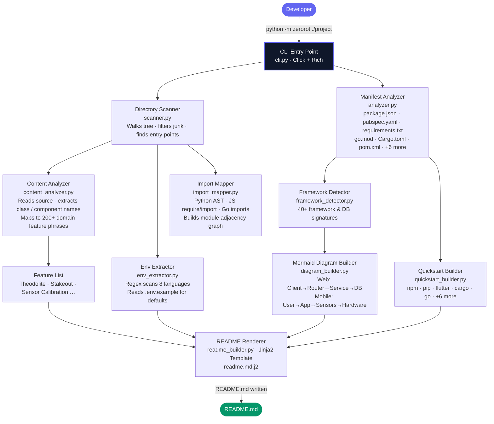

# ZeroRot

> **Auto-generate production-ready `README.md` files from pure static code analysis — no AI API, no cloud, no cost.**
>
> Point ZeroRot at any project folder and it reads your source code, dependency manifests, environment files, component names, and docstrings to produce a structured, accurate README in under a second.

---

## 🏗️ Architecture & Flow



---

## ✨ Features

- **Zero AI API** — 100% static analysis. Works fully offline. No OpenAI, no Gemini, no cost.
- **10+ package ecosystems** — `package.json`, `pubspec.yaml`, `requirements.txt`, `pyproject.toml`, `go.mod`, `Cargo.toml`, `pom.xml`, `build.gradle`, `Gemfile`, `composer.json`
- **8 languages** — Python, JavaScript, TypeScript, Go, Rust, Dart/Flutter, Java, Kotlin, Ruby, PHP
- **Deep content analysis** — reads component/class names, inline docstrings, and `metadata.json` to surface real app features
- **200+ domain vocabulary** — maps `TheodoliteCanvas` → *"Theodolite angle measurement"*, `SensorService` → *"Physical sensor calibration"*, `StakeoutView` → *"Stakeout navigation"* etc.
- **Smart Mermaid diagrams** — web apps get Client→Router→Service→DB flows; mobile apps get User→App→Sensors→Hardware flows
- **Platform-aware quickstart** — generates exact `flutter pub get` / `flutter run`, `cargo build` / `cargo run`, `npm install` / `npm run dev` etc.
- **Env variable table** — extracts every `process.env.X`, `os.getenv()`, `os.environ[]` reference with type inference and defaults from `.env.example`
- **Rich terminal UI** — progress bar, analysis summary table, coloured output

---

## ⚙️ Environment & Configuration

ZeroRot itself has no required environment variables. The `.env.example` is for projects *analysed by* ZeroRot.

Optional runtime knobs:

| Variable | Type | Description | Default |
|---|---|---|---|
| `PYTHONUTF8` | `boolean` | Force UTF-8 output on Windows (set automatically) | `1` on Windows |

---

## 🚀 Quick Start & Execution

> **Prerequisites:** Python ≥ 3.9

### 1. Clone the Repository

```bash
git clone https://github.com/kesavan012/Zerorot.git
cd Zerorot
```

### 2. Create a Virtual Environment

```bash
python -m venv .venv

# Windows
.venv\Scripts\activate

# macOS / Linux
source .venv/bin/activate
```

### 3. Install ZeroRot

```bash
pip install -e .
```

### 4. Run on Any Project

```bash
# Analyse current directory
python -m zerorot .

# Analyse a specific project folder
python -m zerorot "C:\path\to\your\project"

# Custom output file
python -m zerorot "C:\path\to\project" --output DOCS.md

# Overwrite without prompt
python -m zerorot . --force

# Preview without writing
python -m zerorot . --dry-run
```

### 5. Run the Test Suite

```bash
pytest tests/ -v
```

---

## 📁 Component Directory Breakdown

```
Zerorot/
├── zerorot/
│   ├── cli.py                  ← Click CLI · Rich progress bar · analysis summary
│   ├── scanner.py              ← Directory walker · entry-point detection · ASCII tree
│   ├── analyzer.py             ← Multi-manifest parser (10 package ecosystems)
│   ├── content_analyzer.py     ← Source content reader · feature extractor · 200+ vocabulary
│   ├── framework_detector.py   ← Framework & database signature matching
│   ├── env_extractor.py        ← Env-var regex scanner across 8 languages
│   ├── import_mapper.py        ← Module dependency graph (Python AST · JS · Go)
│   ├── diagram_builder.py      ← Mermaid flowchart generator (web + mobile modes)
│   ├── quickstart_builder.py   ← Stack-aware install/run command generator
│   ├── readme_builder.py       ← Jinja2 README assembler
│   ├── utils.py                ← Shared helpers (file detection · safe read · slugify)
│   ├── __main__.py             ← Enables `python -m zerorot`
│   ├── templates/
│   │   └── readme.md.j2        ← Master README Jinja2 template
│   └── data/
│       ├── folder_descriptions.json   ← Folder name → plain-English description map
│       ├── framework_signatures.json  ← Framework / database detection signatures
│       └── env_patterns.json          ← Env-var regex patterns per language
├── tests/
│   ├── test_scanner.py         ← Scanner unit tests (19 assertions)
│   ├── test_env_extractor.py   ← Env extractor unit tests
│   └── fixtures/
│       ├── node_sample/        ← Express.js + PostgreSQL test fixture
│       ├── python_sample/      ← FastAPI + Celery test fixture
│       └── flutter_sample/     ← Flutter total station app test fixture
├── pyproject.toml              ← Package metadata · entry point · dependencies
├── requirements.txt            ← Runtime + dev dependencies
└── .env.example                ← ZeroRot configuration template
```

### Key Components

- **[`cli.py`](zerorot/cli.py)** — The user-facing entry point. Orchestrates all analysis modules, renders a Rich progress bar, prints a summary table, and writes the final `README.md`.
- **[`content_analyzer.py`](zerorot/content_analyzer.py)** — The intelligence layer. Reads actual source content to extract component/class names, docstrings, and `metadata.json` descriptions, then maps them to domain-specific feature phrases using a 200+ term vocabulary.
- **[`diagram_builder.py`](zerorot/diagram_builder.py)** — Generates context-aware Mermaid diagrams: web API projects get a standard Client→Router→Service→DB flow; mobile apps (Flutter/Android/iOS) get a User→App→Services→Hardware flow.
- **[`analyzer.py`](zerorot/analyzer.py)** — Parses 10 different manifest formats to extract project name, version, language, package manager, and all dependencies — the foundation for framework detection and quickstart generation.
- **[`readme.md.j2`](zerorot/templates/readme.md.j2)** — The master template implementing the ZeroRot README schema: title + badges, Mermaid diagram, Features, Environment table, Quickstart, Directory breakdown, attribution.

---

## 🧩 Supported Ecosystems

| Language | Manifest | Package Manager | Run Command |
|---|---|---|---|
| JavaScript / TypeScript | `package.json` | npm / yarn / pnpm / bun | `npm run dev` |
| Python | `requirements.txt` / `pyproject.toml` / `Pipfile` | pip / poetry / pipenv | `python main.py` |
| Dart / Flutter | `pubspec.yaml` | pub | `flutter run` |
| Go | `go.mod` | go | `go run ./cmd/main.go` |
| Rust | `Cargo.toml` | cargo | `cargo run` |
| Java | `pom.xml` / `build.gradle` | maven / gradle | `mvn spring-boot:run` |
| Ruby | `Gemfile` | bundler | `bundle exec rails server` |
| PHP | `composer.json` | composer | `php artisan serve` |

---

## ⚠️ Limitations

- **No semantic understanding** — ZeroRot maps identifier names to features using a vocabulary. If your class names are non-descriptive (e.g. `Manager1`, `Helper2`), no features will be detected.
- **No multi-repo / monorepo support** — Analyses one root directory at a time.
- **Binary / obfuscated code** — Minified JS, compiled bytecode, and encrypted sources are skipped.
- **Framework detection accuracy** — Relies on dependency names. A project with unusual dependency aliases may be mis-classified.
- **Maximum file size** — Files over 200 KB are skipped to keep analysis fast (configurable via `--max-file-size`).

---

[📖 Documentation generated beautifully by ZeroRot](https://zerorot.com)
