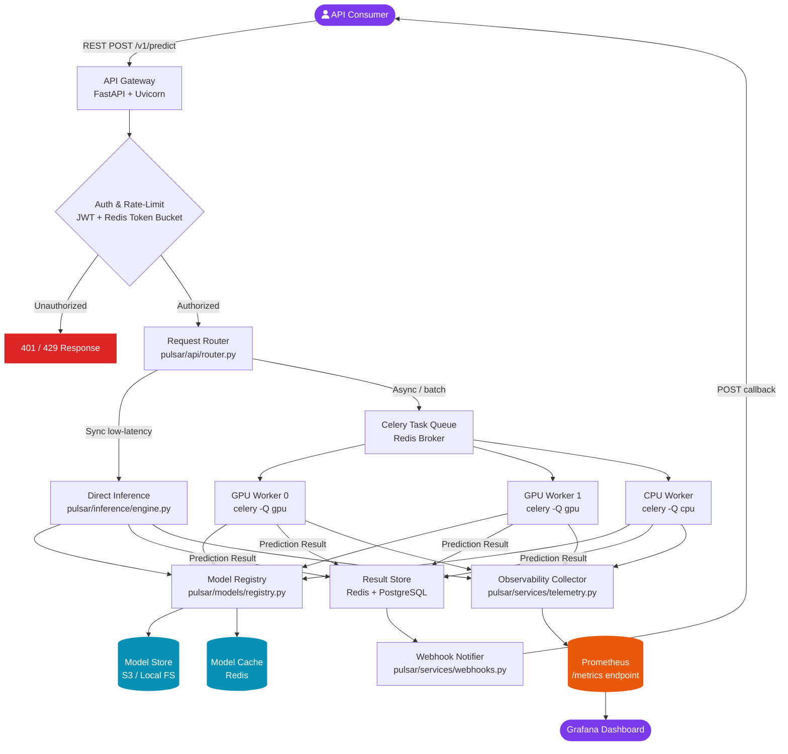

# 🧠 Pulsar — ML Inference Orchestration Platform

> **A production-grade, asynchronous machine learning model serving engine** built on Python, FastAPI, Celery, Redis, and PyTorch. Pulsar exposes a unified REST inference API, manages model lifecycle (load, version, hot-swap), routes prediction tasks to GPU-aware worker pools, and streams real-time telemetry to a monitoring layer — all with sub-100ms cold-start overhead.

---

## 🏗️ Architecture & Flow



---

## ⚙️ Environment & Configuration

All secrets and runtime tunables are loaded via `python-dotenv` from a `.env` file. Copy `.env.example` before first run.

| Variable Name | Type | Description | Default / Required |
|---|---|---|---|
| `APP_ENV` | `string` | Deployment environment: `development`, `staging`, `production` | `development` / **Required** |
| `APP_PORT` | `int` | Uvicorn bind port for the FastAPI server | `8000` |
| `APP_HOST` | `string` | Uvicorn bind host address | `0.0.0.0` |
| `APP_WORKERS` | `int` | Number of Uvicorn worker processes | `4` |
| `SECRET_KEY` | `string` | Secret used for JWT signing (HS256) | — / **Required** |
| `JWT_ALGORITHM` | `string` | JWT signing algorithm | `HS256` |
| `JWT_EXPIRE_MINUTES` | `int` | Access token lifetime in minutes | `60` |
| `DATABASE_URL` | `string` | PostgreSQL async DSN (`postgresql+asyncpg://...`) | — / **Required** |
| `REDIS_URL` | `string` | Redis connection URI used by Celery broker and result backend | `redis://localhost:6379/0` |
| `CELERY_BROKER_URL` | `string` | Explicit Celery broker override (falls back to `REDIS_URL`) | `REDIS_URL` |
| `CELERY_RESULT_BACKEND` | `string` | Celery result store override | `REDIS_URL` |
| `MODEL_STORE_BACKEND` | `string` | Model artifact backend: `local` or `s3` | `local` |
| `MODEL_STORE_PATH` | `string` | Local filesystem path for model artefacts | `./models` |
| `AWS_S3_BUCKET` | `string` | S3 bucket name when `MODEL_STORE_BACKEND=s3` | — / Optional |
| `AWS_ACCESS_KEY_ID` | `string` | AWS credentials for S3 model store | — / Optional |
| `AWS_SECRET_ACCESS_KEY` | `string` | AWS secret key for S3 | — / Optional |
| `AWS_REGION` | `string` | AWS region for S3 | `us-east-1` |
| `GPU_WORKER_CONCURRENCY` | `int` | Celery concurrency for the `gpu` queue | `2` |
| `CPU_WORKER_CONCURRENCY` | `int` | Celery concurrency for the `cpu` queue | `8` |
| `INFERENCE_TIMEOUT_SECONDS` | `int` | Max inference duration before task is revoked | `30` |
| `DIRECT_INFERENCE_MAX_BATCH` | `int` | Maximum batch size for synchronous direct inference | `16` |
| `MODEL_CACHE_TTL_SECONDS` | `int` | Redis TTL for loaded model tensor cache entries | `3600` |
| `WEBHOOK_TIMEOUT_SECONDS` | `int` | HTTP timeout for outbound webhook delivery | `10` |
| `WEBHOOK_MAX_RETRIES` | `int` | Max retry attempts for failed webhook POSTs | `3` |
| `PROMETHEUS_ENABLED` | `bool` | Expose `/metrics` endpoint for Prometheus scraping | `true` |
| `LOG_LEVEL` | `string` | Python logging level: `DEBUG` `INFO` `WARNING` `ERROR` | `INFO` |
| `SENTRY_DSN` | `string` | Sentry DSN for exception tracking | — / Optional |
| `CORS_ORIGINS` | `string` | Comma-separated list of allowed CORS origins | `*` |

---

## 🚀 Quick Start & Execution

> **Prerequisites:** Python ≥ 3.11, PostgreSQL ≥ 15, Redis ≥ 7, CUDA 12.x (optional, for GPU workers), Docker

### 1. Clone & Set Up Virtual Environment

```bash
git clone https://github.com/your-org/pulsar.git
cd pulsar
python -m venv .venv
source .venv/bin/activate        # Windows: .venv\Scripts\activate
```

### 2. Install Dependencies

```bash
# CPU-only
pip install -r requirements.txt

# GPU-enabled (CUDA 12.x)
pip install -r requirements-gpu.txt
```

### 3. Configure Environment

```bash
cp .env.example .env
# Edit .env — fill in SECRET_KEY, DATABASE_URL, REDIS_URL at minimum
```

### 4. Start Infrastructure (Docker)

```bash
docker compose -f docker/compose.dev.yml up -d
# Starts: PostgreSQL 15, Redis 7, Prometheus, Grafana
```

### 5. Run Database Migrations

```bash
alembic upgrade head
```

### 6. Seed Default Model Registry

```bash
python -m pulsar.scripts.seed_models
```

### 7. Launch API Server

```bash
uvicorn pulsar.main:app --host 0.0.0.0 --port 8000 --reload
```

The API is live at `http://localhost:8000`.  
Interactive docs at `http://localhost:8000/docs`.

### 8. Start Celery Workers (separate terminals)

```bash
# GPU inference worker
celery -A pulsar.worker worker -Q gpu --concurrency=2 --loglevel=info

# CPU inference worker
celery -A pulsar.worker worker -Q cpu --concurrency=8 --loglevel=info

# Celery Beat (scheduled tasks: cache eviction, telemetry flush)
celery -A pulsar.worker beat --loglevel=info
```

### 9. Run Tests

```bash
pytest tests/ -v                         # Full test suite
pytest tests/unit/ -v                    # Unit tests only
pytest tests/integration/ -v --tb=short  # Integration tests
pytest --cov=pulsar --cov-report=html    # Coverage report
```

### 10. Production Deployment

```bash
gunicorn pulsar.main:app \
  -w 4 -k uvicorn.workers.UvicornWorker \
  --bind 0.0.0.0:8000 \
  --timeout 60 \
  --access-logfile -
```

---

## 📁 Component Directory Breakdown

```
pulsar/
│
├── pulsar/                          # Main application package
│   │
│   ├── main.py                      # FastAPI app factory — mounts routers, middleware, lifespan hooks
│   ├── config.py                    # Pydantic BaseSettings — loads and validates all env vars
│   ├── worker.py                    # Celery application instance — broker, backend, queue routing config
│   │
│   ├── api/                         # HTTP layer (FastAPI routers)
│   │   ├── router.py                # Root API router — aggregates all sub-routers with version prefix
│   │   ├── v1/
│   │   │   ├── predict.py           # POST /v1/predict — sync and async inference dispatch logic
│   │   │   ├── models.py            # GET/POST /v1/models — model listing, registration, version management
│   │   │   ├── jobs.py              # GET /v1/jobs/{id} — async task status polling and result retrieval
│   │   │   ├── auth.py              # POST /v1/auth/token — credential exchange for JWT access tokens
│   │   │   └── health.py            # GET /v1/health — liveness and readiness probe endpoints
│   │   └── dependencies.py          # FastAPI Depends() factories: DB session, current user, rate-limit
│   │
│   ├── inference/                   # Core ML inference runtime
│   │   ├── engine.py                # Direct inference executor — loads model, runs forward pass, returns result
│   │   ├── pipeline.py              # Pre/post-processing pipeline — tokenisation, normalisation, decoding
│   │   ├── batcher.py               # Dynamic micro-batching logic for throughput optimisation
│   │   └── tasks.py                 # Celery task definitions — @app.task wrappers for async GPU/CPU inference
│   │
│   ├── models/                      # Model lifecycle management
│   │   ├── registry.py              # In-process model registry — load, unload, hot-swap, version tracking
│   │   ├── loader.py                # Model artefact fetcher from local FS or S3 with integrity checks
│   │   └── schemas.py               # Pydantic schemas for model metadata, prediction request/response contracts
│   │
│   ├── services/                    # Cross-cutting service layer
│   │   ├── auth.py                  # JWT creation, validation, and user lookup service
│   │   ├── webhooks.py              # Async outbound webhook dispatcher with retry and backoff
│   │   ├── telemetry.py             # Prometheus metrics collectors — request count, latency histograms, GPU util
│   │   └── cache.py                 # Redis cache helpers — model tensor cache, rate-limit counters
│   │
│   ├── db/                          # Database access layer
│   │   ├── session.py               # SQLAlchemy async session factory and lifespan context manager
│   │   ├── models.py                # ORM table definitions: User, APIKey, PredictionJob, ModelVersion
│   │   └── repositories/            # Repository pattern — typed async CRUD operations per entity
│   │       ├── jobs.py
│   │       ├── models.py
│   │       └── users.py
│   │
│   ├── middleware/                  # ASGI middleware stack
│   │   ├── auth.py                  # JWT bearer extraction and request-context injection
│   │   ├── rate_limit.py            # Redis token-bucket rate limiter keyed by API key
│   │   ├── logging.py               # Structured JSON request/response logging with trace IDs
│   │   └── cors.py                  # CORS policy enforcement from CORS_ORIGINS env var
│   │
│   └── scripts/                     # One-off operational scripts
│       ├── seed_models.py           # Registers default bundled models into the DB registry
│       └── evict_cache.py           # Manual Redis model cache flush utility
│
├── tests/
│   ├── unit/                        # Isolated unit tests with mocked I/O (pytest + unittest.mock)
│   ├── integration/                 # End-to-end API tests against a live test DB and Redis
│   └── conftest.py                  # Pytest fixtures: async test client, DB session, mock Redis
│
├── alembic/
│   ├── env.py                       # Alembic migration environment wired to DATABASE_URL
│   └── versions/                    # Auto-generated, timestamped schema migration scripts
│
├── docker/
│   ├── compose.dev.yml              # Dev stack: PostgreSQL, Redis, Prometheus, Grafana
│   ├── compose.prod.yml             # Production stack with health checks and resource limits
│   └── grafana/
│       └── dashboards/              # Pre-built Grafana dashboard JSON for Pulsar inference metrics
│
├── requirements.txt                 # CPU runtime dependencies (FastAPI, Celery, SQLAlchemy, PyTorch CPU)
├── requirements-gpu.txt             # GPU variant — overrides torch with CUDA 12.x wheel index
├── requirements-dev.txt             # Development extras: pytest, black, ruff, mypy, httpx
├── alembic.ini                      # Alembic configuration pointing to migration directory
├── pyproject.toml                   # Project metadata, black/ruff/mypy tool configuration
├── .env.example                     # Template with all env vars documented inline
└── Makefile                         # Convenience targets: make dev, make test, make migrate, make lint
```

### Key Subsystems at a Glance

- **`pulsar/inference/engine.py`** — The hot path. Acquires a loaded model from the registry, runs the forward pass (with `torch.no_grad()` and optional AMP), applies the post-processing pipeline, and returns a typed `PredictionResult` in under 50ms for cached models.
- **`pulsar/models/registry.py`** — Thread-safe in-memory model registry backed by a Redis lock. Handles version pinning, LRU eviction of unused model weights, and atomic hot-swap with zero downtime during model updates.
- **`pulsar/inference/tasks.py`** — Celery task definitions routed per `gpu`/`cpu` queue. Implements task timeouts via `INFERENCE_TIMEOUT_SECONDS`, structured result serialisation to Redis, and failure-state persistence to PostgreSQL.
- **`pulsar/services/telemetry.py`** — Instruments every inference path with Prometheus counters and histograms (request rate, p50/p95/p99 latency, queue depth, GPU memory utilisation). Automatically exposed at `/metrics`.
- **`pulsar/services/webhooks.py`** — Async outbound notifier that POSTs prediction results to registered callback URLs with configurable timeout, exponential backoff retry, and per-webhook delivery receipts stored in PostgreSQL.
- **`alembic/versions/`** — Full schema history as idempotent migration scripts; run `alembic upgrade head` to reach the latest state from any prior version.

---

[📖 Documentation generated beautifully by ZeroRot](https://zerorot.com)
