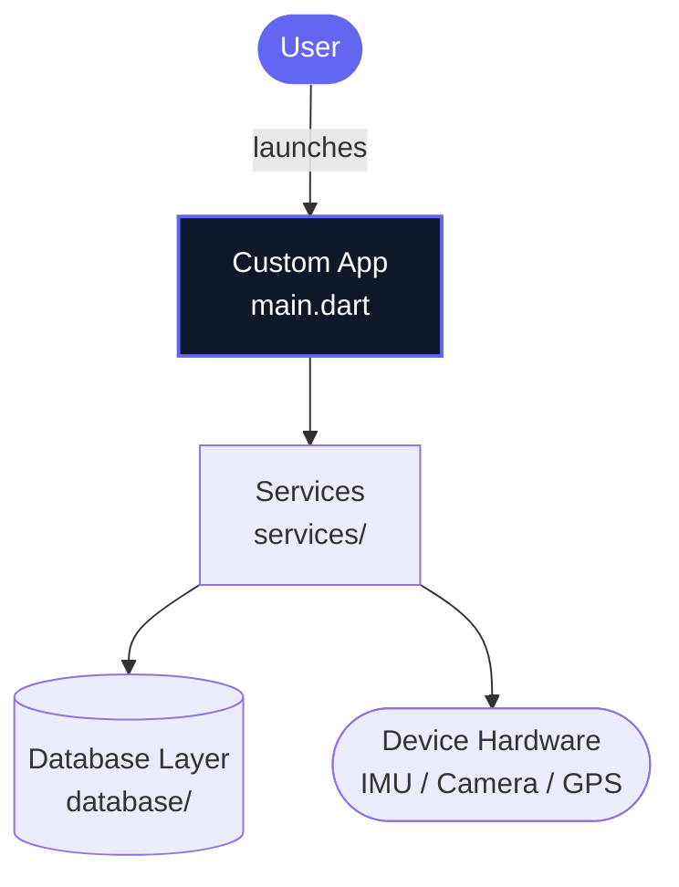

# Geosight
**v1.0.0** · 
> A Flutter + React companion app for total station surveying. Features a digital theodolite, stakeout navigation, traverse survey computation, physical sensor calibration via IMU/magnetometer, AR camera overlay for field guidance, and SQLite-backed offline survey session management with CSV and DXF export.

---

## 🏗️ Architecture & Flow



---

## ✨ Features

- Real-time measurement overlay on live camera feed
- Augmented reality camera overlay for on-site guidance
- Background sensor service for IMU / compass data
- Camera integration for photo documentation
- Database layer for structured data storage and retrieval
- Device sensor (IMU, accelerometer, gyroscope) integration
- SQLite local database for offline data persistence
- Stakeout mode for on-site point placement and navigation
- Theodolite angle measurement and digital display
- GeoSight total station data collection and visualisation
- Physical sensor calibration workflow
- Traverse computation for connected survey points

---

## ⚙️ Environment & Configuration

This project does not require environment variable configuration.

---

## 🚀 Quick Start & Execution

> **Platform:** Flutter / Dart mobile app
> **Prerequisites:** Flutter SDK ≥ 3.0

### 1. Clone the Repository

```bash
git clone https://github.com/your-org/geosight.git
cd geosight
```

### 2. Install Dependencies

```bash
flutter pub get
```

### 3. Start the Application

```bash
flutter run
```

### 4. Run Tests

```bash
flutter test
```


---

## 📁 Component Directory Breakdown

```
flutter_sample/
├── lib/
│   ├── database/
│   │   └── db_helper.dart
│   ├── services/
│   │   └── sensor_service.dart
│   ├── views/
│   │   ├── camera_overlay_view.dart
│   │   ├── stakeout_view.dart
│   │   └── theodolite_view.dart
│   └── main.dart
├── .gitignore
├── metadata.json
├── pubspec.yaml
└── README.md
```

### Key Components

- **`lib/`** — Shared library code — reusable functions and utility classes
- **`lib/database/`** — Database layer — connection setup, query helpers, migration runners
- **`lib/services/`** — Business logic / service layer — core application operations
- **`lib/views/`** — View templates or page components — user-facing rendered screens
- **`pubspec.yaml`** — Flutter / Dart package manifest and dependencies

---

[📖 Documentation generated beautifully by ZeroRot](https://zerorot.com)
